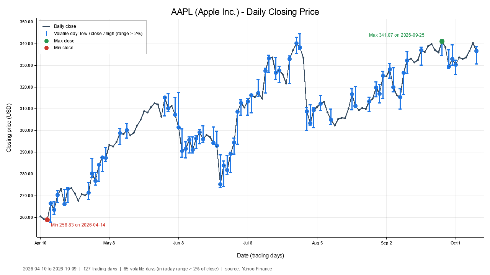

# Stock Market Monitor (ECE 522, Project 1)

A command-line Rust program that takes a stock ticker, downloads the last six months of daily prices from Yahoo Finance, and saves a PNG chart of the daily closing price. Days with a large intraday swing ("volatile days") are drawn with error bars. The program also prints the minimum and maximum closing prices and the dates they occurred.



---

## 1. Crates used and why

| Crate | Version | Why |
|---|---|---|
| [`yahoo_finance_api`](https://crates.io/crates/yahoo_finance_api) | 5.x, `blocking` feature | Free access to Yahoo Finance daily OHLC data (the assignment suggests a Yahoo crate). With the `blocking` feature the calls are ordinary functions, so the program needs no async runtime (no `tokio`) and stays a plain synchronous program. The crate also re-exports the `time` crate, which we use for the `Date` type, so `time` is not a separate dependency. |
| [`plotters`](https://crates.io/crates/plotters) | 0.3.x | Draws the chart and writes it to a PNG through its bitmap backend. It has built-in line series, error bars, legends and axis label formatters, which covers everything the chart needs. |

Everything else is the standard library. Command-line parsing is done by hand with `std::env::args()` in the style of the Rust Book's `minigrep` project (chapters 12 and 13), so `clap` is not needed.

## 2. Financial analysis algorithm

For every trading day the program has the open, high, low and close prices.

**Volatile day.** A day is volatile when the spread between the intraday high and low is more than 2% of that day's closing price:

```
range_pct = (high - low) / close × 100

volatile  ⇔  range_pct > 2
```

"More than 2%" is a strict inequality, so a day at exactly 2.00% is not counted. The 2% threshold is the default; `--threshold` changes it.

**Minimum and maximum close.**

```
min_close = min over all days d of close(d)
max_close = max over all days d of close(d)
```

The date stored with that bar is reported alongside the value. If the same extreme value appears on more than one day, the earliest date is reported.

**Period change.** The report also prints the change over the window as extra context:

```
change_pct = (close_last - close_first) / close_first × 100
```

### Functional style

The analysis is written with iterator adaptors and closures (Rust Book chapter 13) instead of index loops. For example, from [`src/analysis.rs`](src/analysis.rs):

```rust
let max_close = bars.iter().rev().max_by(|a, b| a.close.total_cmp(&b.close))?;
let volatile  = bars.iter().filter(|bar| is_volatile(bar, threshold_pct)).collect();
```

`f64` does not implement `Ord` because of `NaN`, so `.max()` from the assignment example does not compile on prices stored as `f64`. `max_by` with `f64::total_cmp` is the equivalent that works. The y-axis bounds in the chart are computed with a single `fold` over the data.

**Data cleaning.** Before analysis, rows where any price is missing, non-finite, zero or negative, or where `low > high`, are dropped. Yahoo sometimes sends such rows (for example for today's bar while the market is still open).

## 3. Charting setup

- **Chart type:** a line chart of daily closing prices with a small dot on each day. It is not a candlestick chart, because the assignment is about the closing price and a line makes the trend easiest to read.
- **Volatile days:** drawn as blue vertical **error bars** from the intraday low to the intraday high, with a marker at the close (plotters' `ErrorBar::new_vertical(x, low, close, high, ...)`).
- **Min / max close:** a red dot and a green dot, each labelled with its price and date. The label sits to the right of the point in the left half of the chart and to the left of it in the right half, so it never runs off the plot.
- **X axis:** trading-day index (0, 1, 2, ...) with tick labels formatted as calendar dates (`Apr 14`). Using the index rather than calendar time means weekends and holidays leave no gaps in the line. One empty slot of padding is added at each end so the first and last error bars are not clipped.
- **Y axis (autoscaling):** the range is computed from the data: the closes of every day, plus the lows and highs of volatile days (their error bars have to fit). A margin of 8% of the price span is added above and below (at least 1% of the price, so a nearly flat stock still gets a usable axis). The lower bound is clamped at 0.
- **Labels:** the title is `SYMBOL (Company Name) - Daily Closing Price`. The x axis is labelled "Date (trading days)" and the y axis "Closing price (CUR)", where the currency comes from Yahoo (so `SHOP.TO` shows CAD). A legend explains each mark, and a footer line gives the date range, the number of trading days, the number of volatile days and the data source.
- **Output:** a 1280×720 PNG.

## 4. Project setup

**Requirements**

- Rust toolchain (stable, edition 2024, so Rust 1.85 or newer). Install it with [rustup](https://www.rust-lang.org/tools/install) as described in chapter 1 of the Rust Book.
- An internet connection: the first build downloads crates from crates.io, and every run downloads quotes from Yahoo Finance.
- On Linux, `plotters` needs the fontconfig and freetype development packages for text rendering, e.g. `sudo apt install pkg-config libfontconfig1-dev libfreetype6-dev`. Windows and macOS need nothing extra.

**Build**

```bash
cd Project_1
cargo build --release
```

**Run the tests** (16 unit tests: argument parsing, volatility and min/max logic, data cleaning, error mapping, date labels; none of them need the network)

```bash
cargo test
```

## 5. Usage

```bash
cargo run --release -- <SYMBOL> [OPTIONS]
```

or run the compiled binary directly: `./target/release/stock_monitor <SYMBOL>` (`.\target\release\stock_monitor.exe` on Windows).

| Option | Meaning | Default |
|---|---|---|
| `<SYMBOL>` | Ticker, case-insensitive: `AAPL`, `msft`, `SHOP.TO`, `^GSPC`, `BTC-USD` | required |
| `-o`, `--output <FILE>` | Where to save the PNG | `output/<SYMBOL>_6mo.png` |
| `-t`, `--threshold <PERCENT>` | Volatility threshold in percent | `2` |
| `-h`, `--help` | Show help and exit | |

**Examples**

```bash
cargo run --release -- AAPL
cargo run --release -- msft --threshold 3 --output charts/msft.png
cargo run --release -- --help
```

**Where to find the output**

- The **chart** goes to `output/<SYMBOL>_6mo.png`, relative to the directory you ran the command from (or to the path given with `--output`). The folder is created automatically, and the exact path is printed as the last line of the run.
- The **minimum and maximum closing prices with their dates**, the change over the period, and a table of every volatile day (low, high, close, range %) are printed to the terminal.

Example terminal output (shortened):

```
Fetching six months of daily quotes for AAPL ...

AAPL - Apple Inc.
Period: 2026-04-10 to 2026-10-09 (127 trading days)

  Minimum close:     258.83 USD on 2026-04-14
  Maximum close:     341.07 USD on 2026-09-25
  Change over period: +29.24%

Volatile days (high - low > 2% of close): 65
  Date          Low        High       Close      Range
  2026-04-15     257.81     266.56     266.43    3.28%
  ...

Chart saved to output\AAPL_6mo.png
```

**Bad input does not crash the program.** Every failure is turned into an error value and printed as a message, with a non-zero exit code:

```
$ stock_monitor ZZZZQQ
error: no price data found for "ZZZZQQ". Check that the ticker symbol is correct.

$ stock_monitor 'AA$PL'
error: `AA$PL` is not a valid ticker symbol
Try `stock_monitor --help` for usage.
```

Exit codes: `0` success, `1` data or chart error (unknown ticker, no network), `2` bad command-line arguments.

## Code layout

```
src/
├── main.rs      entry point: parse args, call run(), print errors, set exit code
├── lib.rs       run(): fetch -> analyse -> draw -> print report
├── cli.rs       hand-written argument parser and --help text
├── quotes.rs    Yahoo Finance download, conversion to DailyBar, data cleaning
├── analysis.rs  volatility test, min/max close, period change
├── chart.rs     plotters chart
└── error.rs     MonitorError enum used by every module
```

The structure follows the Rust Book: the binary/library split from chapter 12, modules from chapter 7, `Result` and `?` error propagation with a custom error type from chapter 9, unit tests in `#[cfg(test)]` modules from chapter 11, and iterators and closures from chapter 13. No `unwrap()` or `expect()` runs on any path that depends on user input or network data.
